# 🔍 Infinity Lens — Receipt-scanning expense app for iPhone

🌐 **English** · [Español](README_es.md)

An iPhone app that turns a photo of a receipt into a tidy expense (**total, date, merchant, category**) and also tracks bills, subscriptions, budgets and warranties. Everything happens on the device: **no server, no account, no ads, no internet.**

🔗 Landing page: [lens.infinitydev.agency](https://lens.infinitydev.agency)

  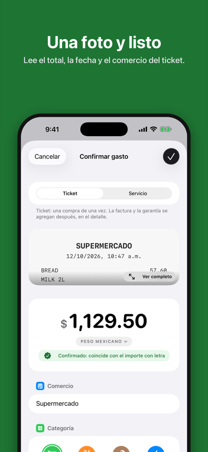
  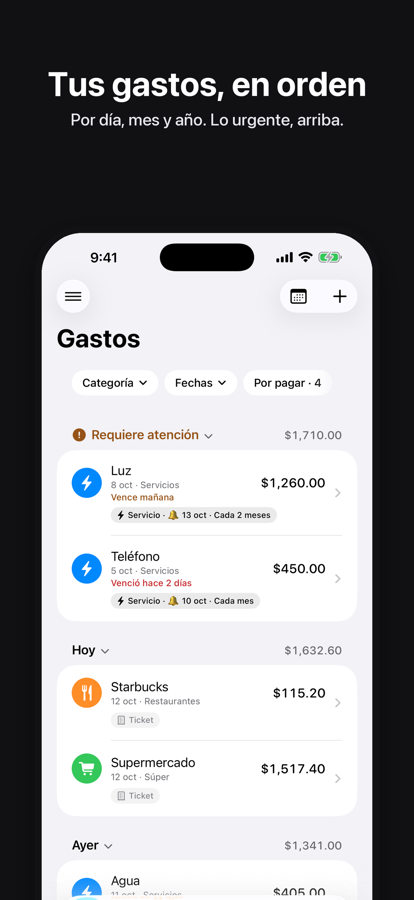

---

## 🎯 About the project

I wanted an expense app where photographing the receipt is enough, under three constraints that pull against each other:

1. **Data never leaves the phone** — no server, no account, no network.
2. **It must not be wrong silently** — a misread total is worse than an empty one.
3. **It had to be a product, not an exercise** — languages, accessibility, business model and App Store release.

I came from React and **did not know Swift**, so the project was also a crash course in a new platform.

> **Role:** designed, built, translated and prepared for release end to end.

## ✨ Features

| | |
|---|---|
| 📷 **Scan** | Camera (multi-page), photo, PDF or manual entry; user always confirms before saving |
| 🧾 **Bills & reminders** | Reads the due date, local reminders, auto-creates the next period |
| 📅 **Payment calendar** | Overdue / pending / paid at a glance |
| 🔁 **Subscriptions** | Monthly and yearly spend, cancelled ones stay in history |
| 💸 **Budgets** | Per-category limits, warning at 80 % |
| 🧰 **Work & keep** | Reimbursable expenses, invoices (PDF/XML), warranties, 15 currencies, CSV and PDF export |
| 🔐 **Privacy** | Encrypted backup, optional Face ID lock |
| 🌍 **6 languages** | ES, EN, PT-BR, FR, DE, IT · light/dark · large text · VoiceOver labels |

## 🖼️ Gallery

  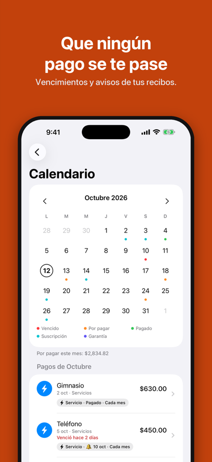
  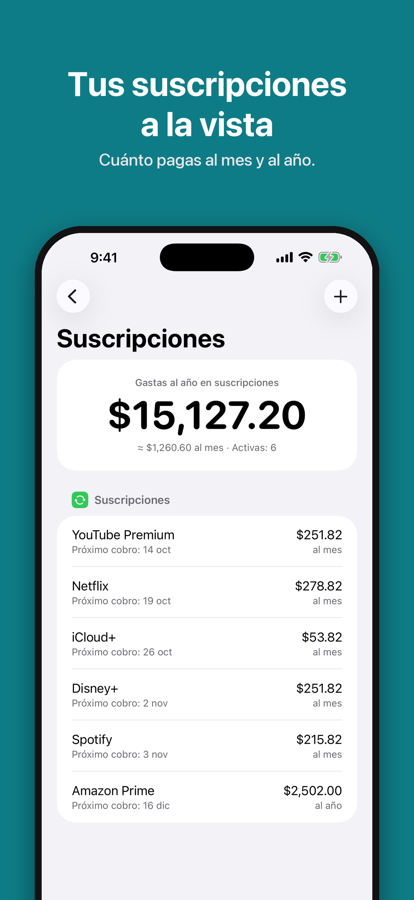
  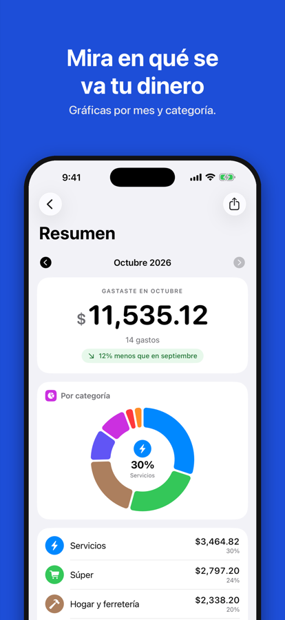
  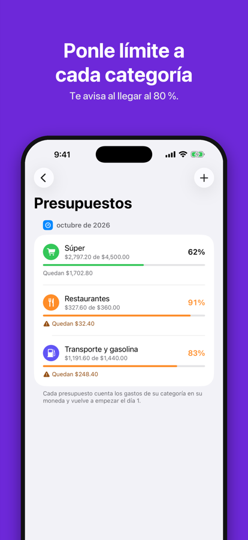

  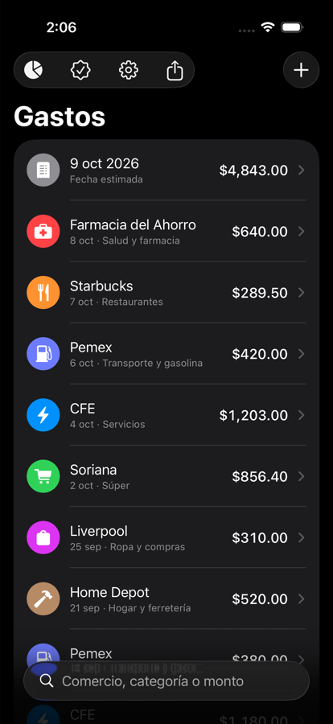
  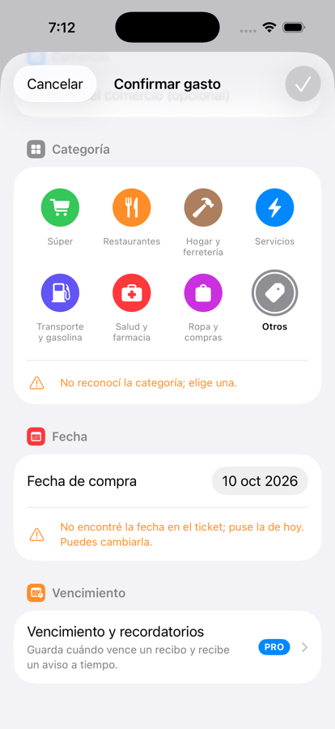
  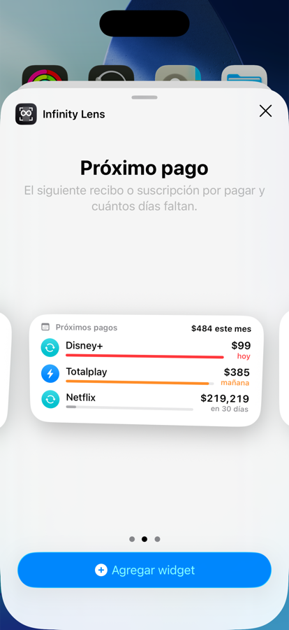
  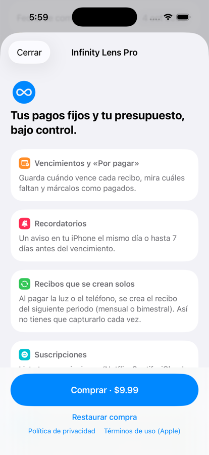

## 🛠️ Tech stack

| Technology | Role |
|---|---|
| Swift 6 · SwiftUI | Native iOS interface (iOS 18+) |
| SwiftData | Local persistence (new fields always optional so existing data migrates) |
| Swift Charts | Category donut and monthly bars |
| Vision · VisionKit · PDFKit | On-device OCR, document scanner, PDF reading |
| WidgetKit | Home and lock-screen widgets |
| StoreKit 2 | One-time Pro purchase, no server |
| LocalAuthentication | Face ID lock |
| CryptoKit | PBKDF2-HMAC-SHA256 (600k rounds) + AES-256-GCM encrypted backups |
| `TicketKit` (own Swift package) | All non-UI logic, 318 automated tests |
| Astro · React · Tailwind | Trilingual landing site on Cloudflare |

## 🧠 Key technical decisions

### Reading a receipt without AI
The original plan used a 2B-parameter on-device LLM. I measured first: Apple Vision + rules already met the target, so the LLM was **deferred** (less memory, less risk, no 1.5 GB download).

- **Three independent ways to read the total** are cross-checked: the "TOTAL" label, *cash − change*, and the **amount in words** ("OCHENTA Y UN PESOS 65/100"). If two agree the app says so; if they conflict, it leaves the field empty.
- **Design rule: prefer empty over wrong.** I removed heuristics that "guessed" even when they raised the hit rate.
- **Ambiguous dates** (`10/05/2026`) follow the phone's region and warn when estimated.
- **Own CLI tool `ocr-check`** runs the OCR over a folder and compares with ground truth: total 78 %, date 93 %, merchant 100 %, category 84 %, **0 wrong**.
- **Honest caveat:** measured on ~20 of my own photos, so the numbers are biased. I documented it instead of overfitting.

  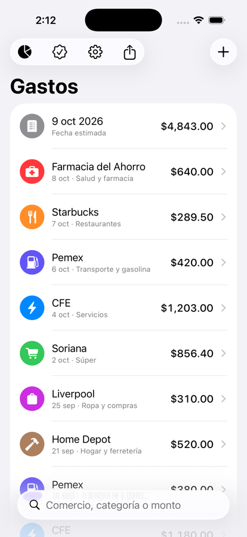
  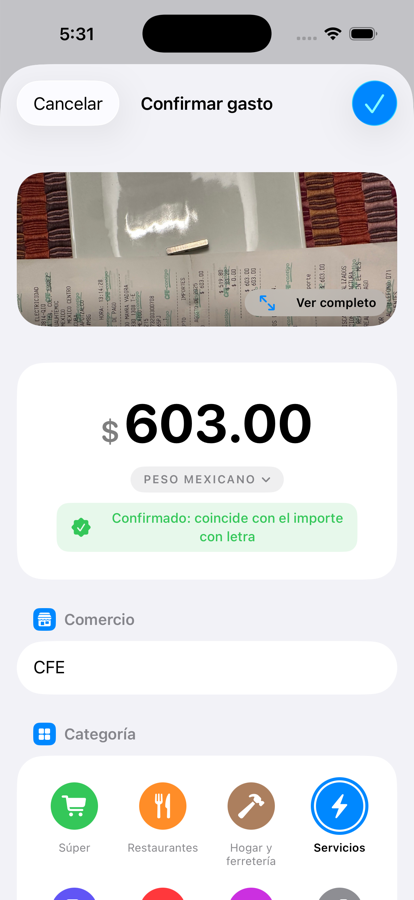

### Logic separated from the UI
Everything that isn't interface lives in the `TicketKit` Swift package (~6,800 lines incl. tests): OCR rules, money formats, filters, calendar, reminders, encryption. **318 tests** run in seconds with no simulator; the app (~9,700 lines of SwiftUI) only draws. Migration was tested by hand-copying a database of the previous schema.

### Privacy as a design decision
- The app makes **no network connections of its own**; the App Store label "data not collected" is true.
- **Encrypted backup** (min. 8-char password, random salt, AES-256-GCM that also detects tampering). Restore only *adds*, never replaces, and loading the same backup twice doesn't duplicate.
- A project rule: any feature that changes what the app does with data must update the in-app privacy screen, the public policy, Apple's privacy manifest and the App Store Connect labels together.

  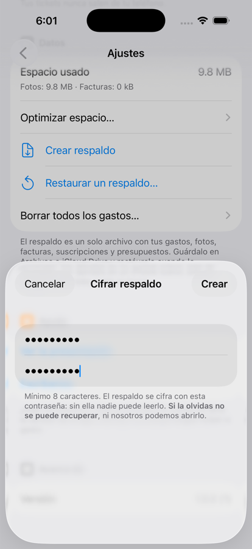
  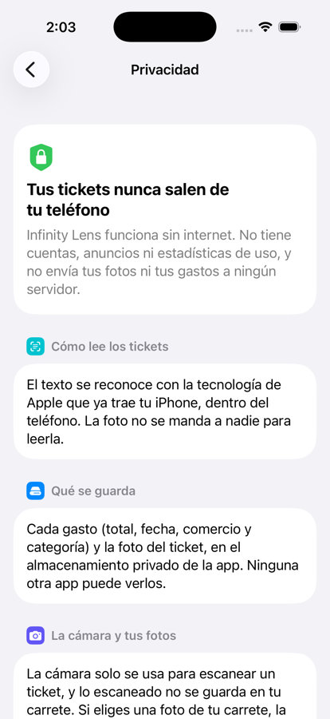

### Product: free vs. Pro
I replaced "free up to 30 expenses" with a **one-time Pro purchase** and everything basic free and unlimited. The boundary is per **feature**, and **already-captured data is never locked**. I also **rejected automatic exchange rates over the internet**: it would break the "no internet" promise, the main differentiator.

### Accessibility you can measure
I wrote a tool that computes WCAG contrast of small text with real iOS colors and raised everything to **4.5:1**. Layouts were checked up to the largest accessibility text size.

  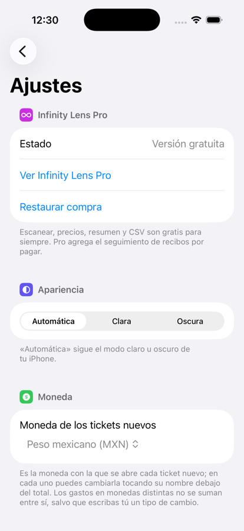
  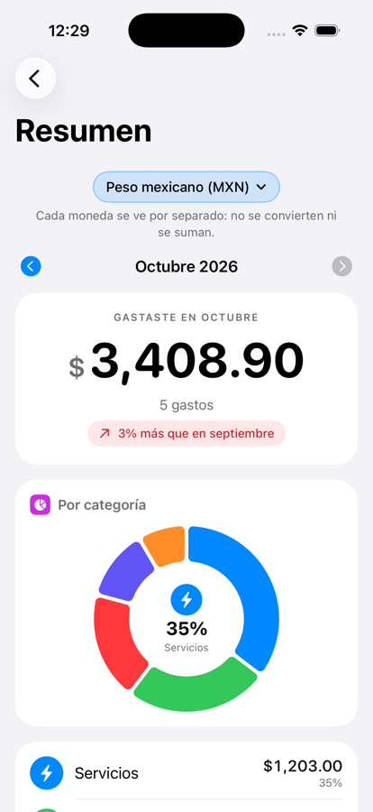
  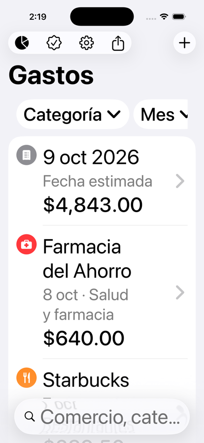

### Six languages, not just translation
~500 strings via Xcode string catalogs; OCR also understands English and Portuguese receipts (cash/change, *dinheiro/troco*, local date and currency formats). The App Store listing is generated by a **script for 11 regional variants** that validates Apple's length limits.

  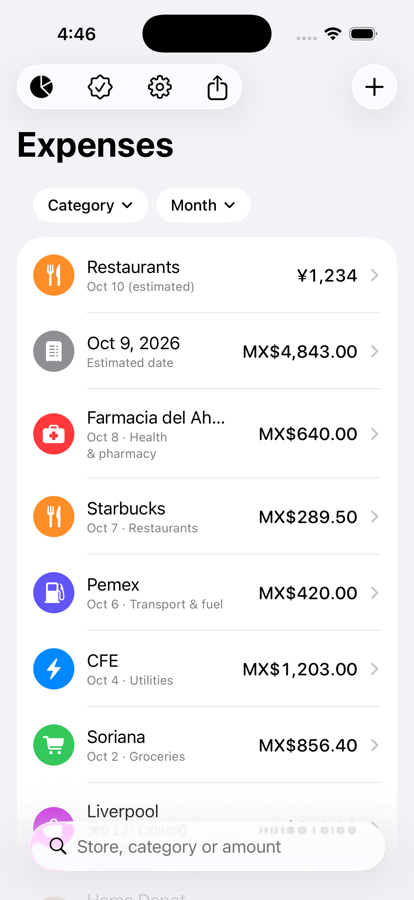
  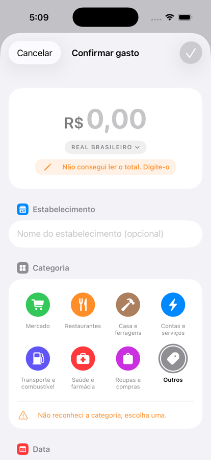
  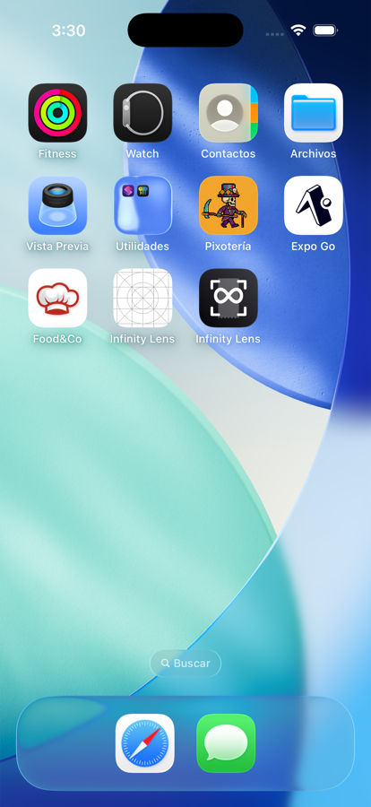

## 🌱 What I learned / what I'd improve

- Measure first: the LLM that seemed necessary wasn't.

## 📬 Contact

**Infinity dev by Frank** · [GitHub](https://github.com/TheGeistGamer) · [Infinity](https://infinitydev.agency)
